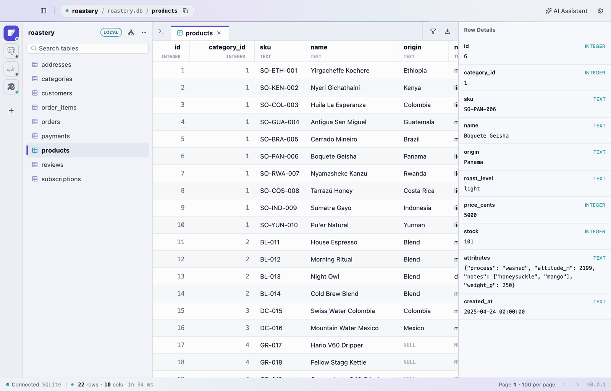
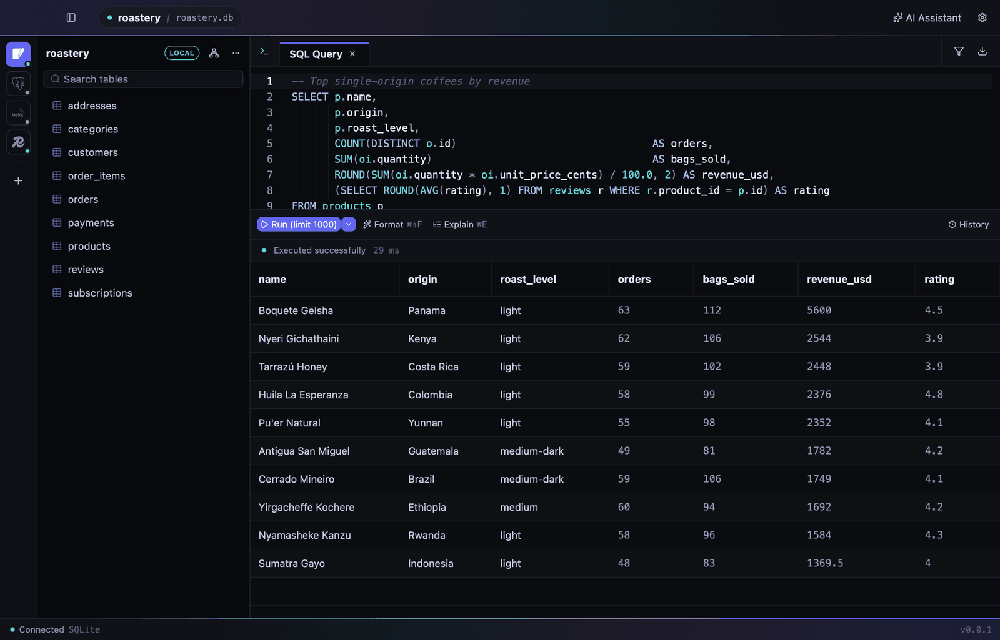
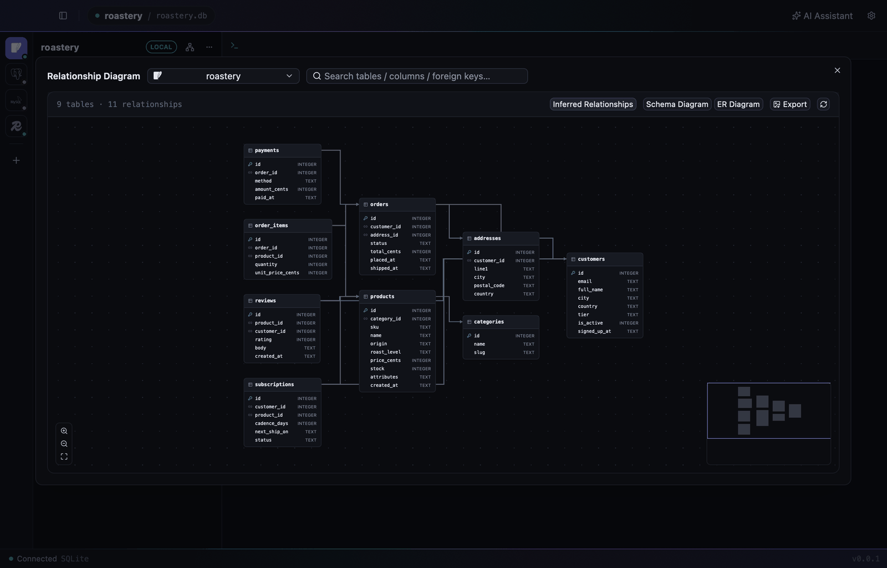
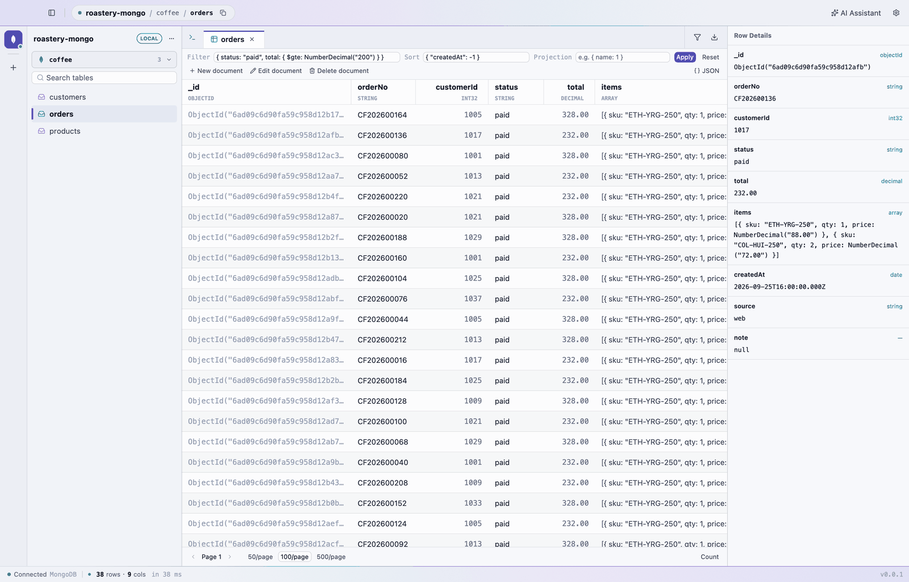
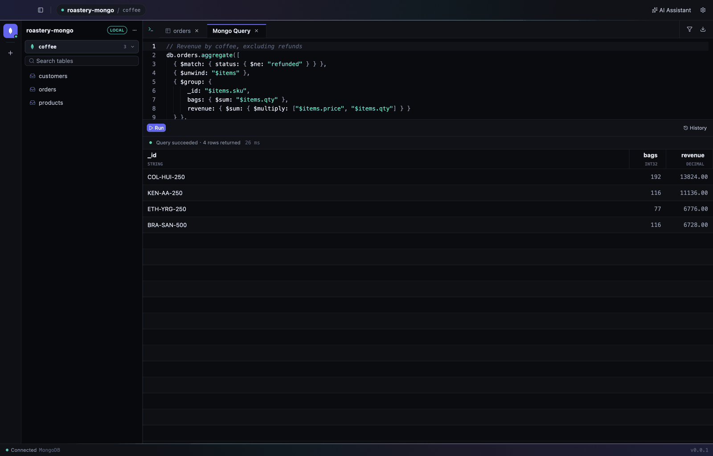
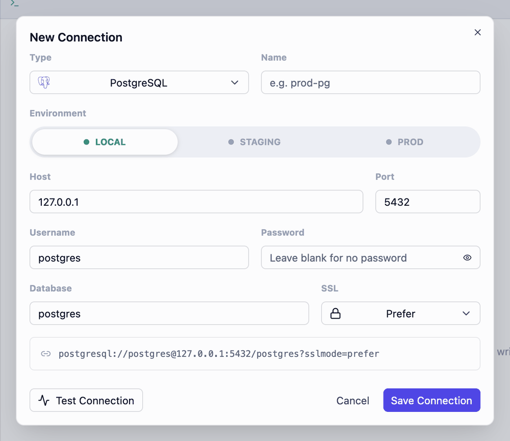
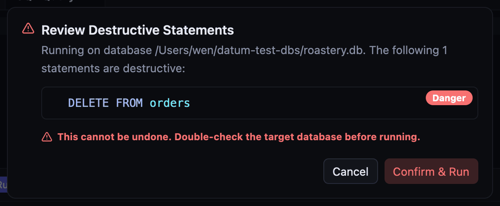

# Datum

English | [简体中文](README.zh-CN.md) | [繁體中文](README.zh-TW.md)

A clean, modern desktop database client for **PostgreSQL**, **MySQL**, **SQLite**, **Redis** and **MongoDB**.

This is the native Rust rewrite of Datum: the UI is built on [GPUI Kit](https://github.com/longbridge/gpui-kit) (GPUI + gpui-component),
and the data layer reuses the Rust backend of the original Tauri version — no WebView, no Node.js.

> Datum (/ˈdeɪtəm/, the singular of "data") — a tool focused on your data.

<p align="center">
  
</p>

## A look around

**Write SQL the way you think.** Completion knows your tables, aliases and columns; hit ⌘↵ to run just the statement under the cursor. Dark mode included.



**See how everything connects.** The ER diagram picks up real foreign keys and infers the ones you only expressed through `xxx_id` naming.



**MongoDB, the way you already query it.** Open a collection to page through documents with Filter / Sort / Projection, flip between a table and JSON, and edit whole documents without types silently changing. The query tab speaks a mongosh subset — `find`, `aggregate`, `updateMany` and friends.





**Hard to shoot yourself in the foot.** Connections are tagged local / staging / prod, and anything destructive waits for an explicit confirmation.

<table>
  <tr>
    <td width="50%"></td>
    <td width="50%"></td>
  </tr>
</table>

<sub>Screenshots use a made-up coffee roastery database and were rendered with the headless snapshot mode described under <a href="#headless-screenshots">Development</a>.</sub>

## Features

- **Connections**: create / edit / delete / test connections with a live connection-string preview; SSL mode (disable / prefer / require / verify-full — for PG and MySQL, "prefer" falls back to plaintext when the server has no TLS); color-coded environments (local / staging / prod); credentials routed by environment — `local` stored in plain text on disk, `staging/prod` in the macOS Keychain; switch databases from the sidebar (reuses the same instance or clones the connection), export / drop a database from its context menu
- **Table browsing**: server-side pagination and sorting, column colors by type, result filters (AND / OR, many operators), full-cell viewer (JSON auto-formatted), staged edits and deletes committed in a single transaction with ⌘S, copy as INSERT, export to CSV / SQL / Markdown
- **SQL editor**: syntax highlighting, schema-aware completion (tables, `table.` / alias columns, in-scope columns, clause templates), keyword auto-uppercasing, run the statement under the cursor or the selection, formatting, Explain, row limit, per-database query history
- **Destructive statement review**: DROP / TRUNCATE / DELETE or UPDATE without WHERE, etc. require confirmation before running; Redis FLUSHALL / FLUSHDB are intercepted too; read-only execution is enforced by the database itself (PG `default_transaction_read_only`, MySQL `SESSION TRANSACTION READ ONLY`, SQLite `query_only`)
- **MongoDB**: connect with fields or a connection string (incl. Atlas `mongodb+srv://`; the password is split out and stored like other credentials); browse collections with Filter / Sort / Projection, server-side paging and counts, table or JSON view; edit, insert and delete whole documents in a mongosh-style editor that round-trips every BSON type (`NumberLong`, `NumberDecimal`, `ISODate`, `ObjectId`, …); a query tab for a mongosh subset (`find` with `sort/skip/limit/projection`, `findOne`, `countDocuments`, `distinct`, `aggregate`, `getIndexes`, `insertOne/Many`, `updateOne/Many`, `replaceOne`, `deleteOne/Many`, `show dbs/collections`) with collection-name completion; empty-filter bulk writes and `$out` / `$merge` pipelines go through the destructive review; reads are capped at 60 s server-side
- **Redis**: browse keys, type-aware value views, run any command (with command and key-name completion), key details (type / TTL / size)
- **AI assistant**: multiple providers (OpenAI-compatible / Anthropic / Gemini, with presets for DeepSeek, Qwen, Kimi and more), switch models inside the panel; per-connection conversations; table schemas and knowledge-base documents injected automatically (ships with database development guidelines, replaceable); generated SQL is shown as cards you confirm before running or open in the editor
- **ER diagram**: physical foreign keys plus logical ones inferred from `xxx_id` naming, layered layout, drag, zoom, search highlighting, schema view / engineering ER view, PNG export
- **Import**: import from a .sql file or pasted text in a single transaction (rolls back entirely on failure and points to the failing statement)
- **Interface**: English / 简体中文 / 繁體中文 (follows the system by default; AI prompts and the built-in guidelines switch with the language), light / dark / system theme, font and size settings, resizable panes, tabs, in-app updates

## Install

Download `Datum_<version>_aarch64.dmg` from [Releases](https://github.com/wenlingang/datum/releases) and drag Datum into Applications.

Datum is not notarized by Apple yet, so macOS blocks it on first launch. Allow it once using either method (in-app updates are not affected afterwards):

- Open "System Settings → Privacy & Security", find the Datum notice near the bottom and click "Open Anyway";
- Or run `xattr -dr com.apple.quarantine /Applications/Datum.app` in Terminal.

The app then checks for updates automatically. Update packages carry an Ed25519 signature and are installed only if verification passes.

## Layout

```text
crates/
├── core/   datum-core: connections, credentials, history, PG/MySQL/SQLite/Redis/MongoDB drivers, AI, self-update,
│           plus pure logic for SQL splitting / risk detection / generation / formatting,
│           filtering, sorting, export, ER layout and completion
└── app/    datum: GPUI Kit UI (workspace, tabs, result grid, dialogs, AI panel, ER diagram)
```

## Requirements

- **Rust** ≥ 1.88 (developed and verified with 1.96)
- **macOS** (current packaging target; GPUI itself supports Linux / Windows)
- Data-layer integration tests need reachable local PostgreSQL / Redis / MongoDB instances (or Docker)

## Development

```bash
cargo run                  # launch the app
cargo test --workspace     # unit tests (data-layer integration tests are ignored by default)
```

Configuration lives in the same directory as the old version (`~/Library/Application Support/com.dbstudio.app`), so connections, history and AI settings carry over when upgrading from the Tauri version.
Use `DATUM_CONFIG_DIR=/some/dir cargo run` to point development builds at a separate config directory.

### Headless screenshots

Where screen recording is unavailable (CI, remote sessions), GPUI's Metal headless renderer can run a script and take a screenshot:

```bash
DATUM_CONFIG_DIR=/tmp/datum-cfg \
DATUM_SNAPSHOT="conn:<connection id>;wait:600;table:users;wait:500;shot:/tmp/a.png" \
cargo run --features snapshot
```

See `snapshot_step` in `crates/app/src/workspace/mod.rs` for available steps (`query`, `sql:`, `run`, `detail`, `ai`, `erd`, `settings`, `theme:light`, `key:cmd-enter`, …).

### Integration tests (need databases)

```bash
cargo test -p datum-core -- --ignored --test-threads=1
```

Override the test connections with `DBSTUDIO_TEST_PG` (libpq connection string), `DBSTUDIO_TEST_MYSQL` (mysql URL) and `DBSTUDIO_TEST_REDIS` (redis URL).

The TLS tests connect to local databases by port; tests whose variable is unset are skipped:

```bash
DATUM_TLS_PG_PLAIN=5432 DATUM_TLS_PG_SSL=5444 DATUM_TLS_MYSQL=3306 DATUM_TLS_REDIS=6379 \
  cargo test -p datum-core --test tls -- --ignored --test-threads=1
```

`DATUM_TLS_PG_SSL` points to a PG with `ssl=on` (a self-signed certificate is fine); `DATUM_TLS_PG_PLAIN` / `DATUM_TLS_REDIS` point to instances without TLS.

The MongoDB tests run against a local instance on the given port:

```bash
docker run -d --name datum-mongo -p 27017:27017 mongo:7
DATUM_MONGO=27017 cargo test -p datum-core --test mongo -- --ignored --test-threads=1
```

Set `DATUM_MONGO_AUTH=<port>` as well to run the authentication cases against an instance started with a root user (see `crates/core/tests/mongo.rs` for the setup).

## Packaging and releases

### Releasing (GitHub Actions)

After bumping and committing the version, push an annotated tag with the same name. The tag message becomes the in-app release notes:

```bash
# after setting version = 0.0.2 in Cargo.toml and committing
git tag -a v0.0.2 -m "What changed in this release"
git push origin v0.0.2
```

`.github/workflows/release.yml` runs on macOS: check the tag matches the version → run tests → build → code-sign →
notarize (when an Apple certificate is configured) → sign the update package → create a Release in this repository (assets: dmg, self-update zip, `latest.json`).
It can also be run manually from the Actions page (pick an existing tag; optionally build a universal Apple Silicon + Intel package).

Configure these under Settings → Secrets and variables → Actions:

| Secret | Required | Content |
| --- | --- | --- |
| `UPDATE_SIGNING_KEY` | Yes | Private key for signing update packages (see "Keys" below) |
| `MACOS_CERT_P12` | No | Code-signing certificate (with private key) as .p12, base64-encoded; ad-hoc signing if absent |
| `MACOS_CERT_PASSWORD` | No | Password of the .p12 above |
| `NOTARY_API_KEY` / `NOTARY_KEY_ID` / `NOTARY_ISSUER` | No | App Store Connect API key (full .p8, Key ID, Issuer ID); only Developer ID certificates can be notarized |

### Keys

**Update signing key** (required). The app embeds the public key (`UPDATE_PUBLIC_KEY` in `crates/core/src/update.rs`) and installs only update packages signed with the matching private key.
If the private key is lost you can no longer ship updates to existing users — back it up. If it leaks, rotate the key and have users reinstall manually.

```bash
cargo run -p datum-core --bin datum-sign -- keygen ~/.config/datum/update-signing.key   # prints the public key
gh secret set UPDATE_SIGNING_KEY < ~/.config/datum/update-signing.key
```

**Code-signing certificate** (recommended). Without an Apple Developer account, use a self-signed code-signing certificate: the signing identity stays stable,
so users' "Always Allow" for Keychain items (staging / prod passwords) survives updates; with ad-hoc signing they must re-authorize after every update.

```bash
openssl req -x509 -newkey rsa:3072 -nodes -days 3650 -keyout codesign.key -out codesign.crt \
  -subj "/CN=Datum Self-Signed Code Signing" -addext "basicConstraints=critical,CA:false" \
  -addext "keyUsage=critical,digitalSignature" -addext "extendedKeyUsage=critical,codeSigning"
openssl pkcs12 -export -legacy -inkey codesign.key -in codesign.crt \
  -name "Datum Self-Signed Code Signing" -out codesign.p12   # needs OpenSSL 3; -legacy lets macOS import it
base64 -i codesign.p12 | gh secret set MACOS_CERT_P12
gh secret set MACOS_CERT_PASSWORD   # enter the password set during export
```

Once you have an Apple Developer account, replace `MACOS_CERT_P12` with a Developer ID certificate and configure the notarization secrets — users don't need to reinstall.

### Local packaging and testing

```bash
script/bundle-macos.sh               # unsigned Datum.app
script/bundle-macos.sh --universal   # universal Apple Silicon + Intel package
script/release-macos.sh              # ad-hoc signing + update signature + latest.json (reads ~/.config/datum/update-signing.key)
DATUM_SIGN_IDENTITY="…" script/release-macos.sh --notes "…" --publish   # manual release when CI is unavailable
```

Artifacts go to `target/bundle/`. On launch the app silently checks `latest.json` attached to this repository's latest Release
(`UPDATE_MANIFEST_URL`, see `crates/core/src/update.rs`):

```jsonc
{
  "version": "0.0.1",
  "url": "<direct DMG download link>",
  "zip_url": "<direct .app zip download link>",
  "sha256": "<SHA-256 of the zip>",
  "signature": "<Ed25519 signature of the zip>",
  "notes": "What changed in this release"
}
```

In-app updates verify, in order: the SHA-256 matches the manifest, the Ed25519 signature is valid, the new bundle has the same Bundle ID as the running app,
and — if the running app is Developer ID signed — the new bundle is fully signed by the same developer team. The app is replaced in place only if all checks pass.

## Keyboard shortcuts

| Shortcut | Action |
| --- | --- |
| ⌘↵ | Run the statement under the cursor / the selection |
| ⌘⇧F | Format SQL |
| ⌘E | Explain |
| ⌘Y | Query history |
| ⌘⇧A | Send selected SQL to the AI assistant |
| ⌘F | Filter results (find inside the editor) |
| ⌘S | Commit staged edits and deletes |
| ⌘R | Refresh the current tab and table list |
| ⌘T / ⌘W | New query / close tab |
| ⌘B | Show / hide the sidebar |
| ⌘, | Settings |
