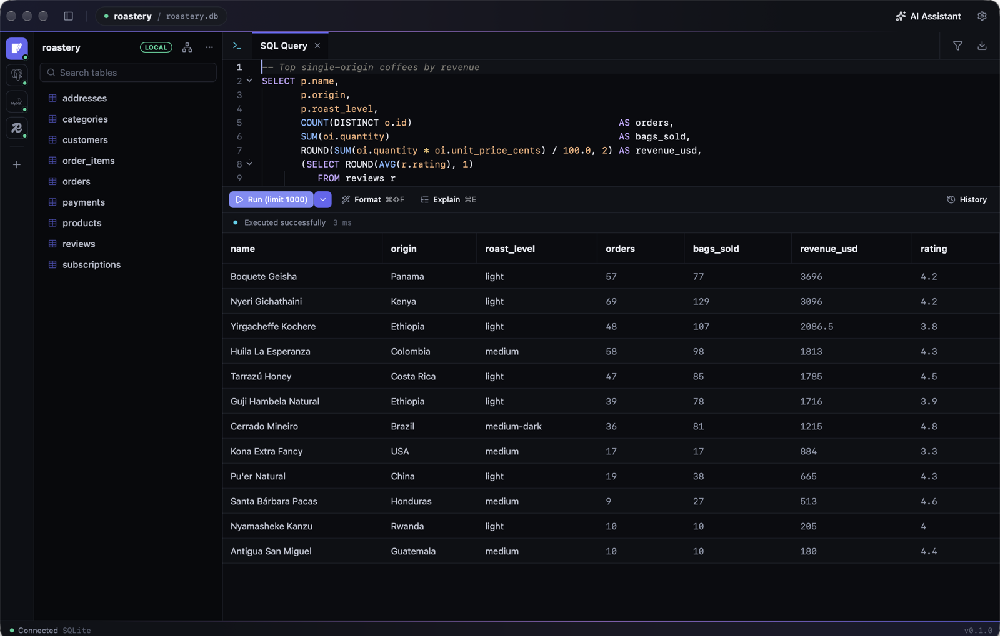

# Datum

English | [简体中文](README.zh-CN.md) | [繁體中文](README.zh-TW.md)

A lightweight, fast-starting desktop database client for **PostgreSQL**, **MySQL**, **SQLite** and **Redis**, on **macOS**, **Windows** and **Linux**.

**👉 Overview, screenshots, features and downloads: [wenlingang.github.io/datum](https://wenlingang.github.io/datum/)**

<p align="center">
  <a href="https://wenlingang.github.io/datum/"></a>
</p>

## Download

Get the package for your platform from [Releases](https://github.com/wenlingang/datum/releases/latest); installation notes are on [the website](https://wenlingang.github.io/datum/#install).

## Development

The UI is written in TSX on [nsh](https://nsh.dev) and drawn with each platform's native views; the data layer is Rust (`crates/core`), exposed to the UI through the native module in `app/native`.

```text
crates/core/   data layer: connections, credentials, history, PG/MySQL/SQLite/Redis drivers, AI, SQL risk checks, formatting…
app/           the nsh app: App.tsx, nsh.json, theme.json, locales/
  native/      the datum/native native module (Rust)
  workspace/   shell   tab/ query & table tabs   dialogs/   chat/ AI panel   ui/ store/ lib/
site/          the website (GitHub Pages)
```

You need Rust ≥ 1.97 and the nsh CLI, built from the same commit as the nsh crates pinned in `app/native/Cargo.toml` (install it with `script/install-nsh.sh`).

```bash
cd app
nsh check && nsh build                     # type check and build
DATUM_CONFIG_DIR=/tmp/datum-dev nsh run    # run with a separate config dir, away from your real connections
cd .. && app/testing/run-tests.sh core     # core tests
```

Testing, packaging, releases, certificates and keys: see [docs/release.md](docs/release.md) (Simplified Chinese).
