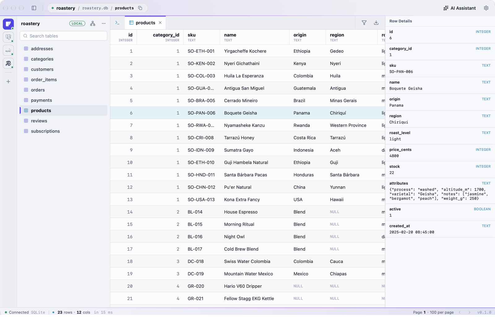
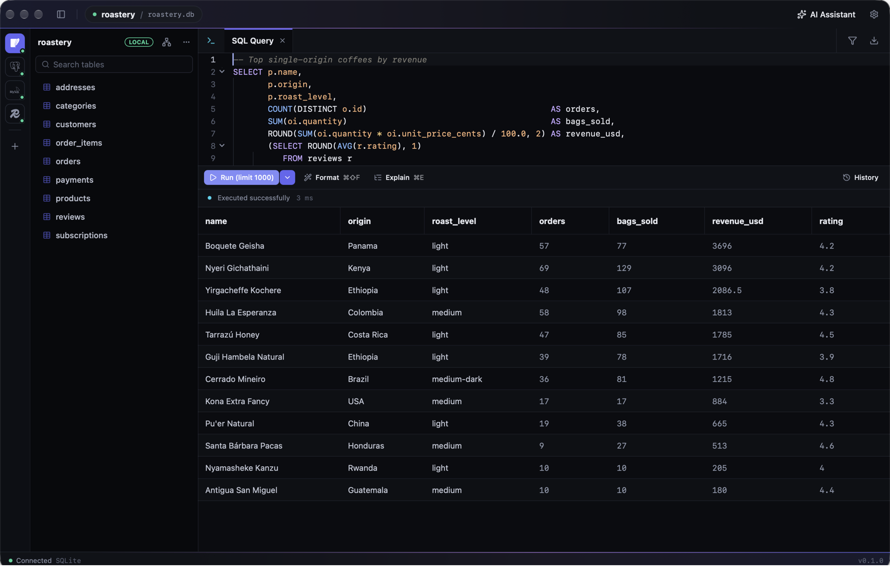
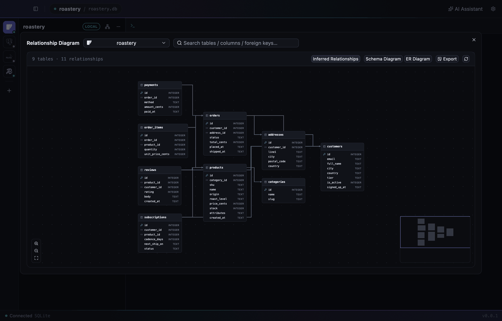
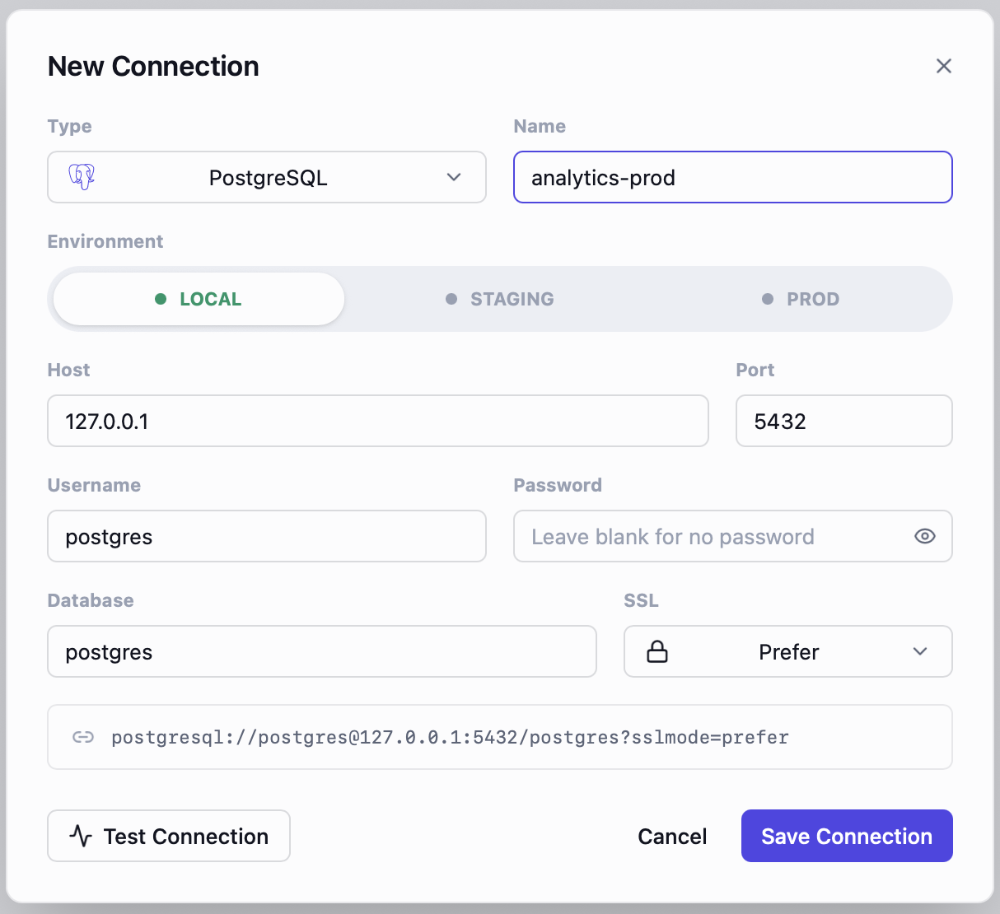
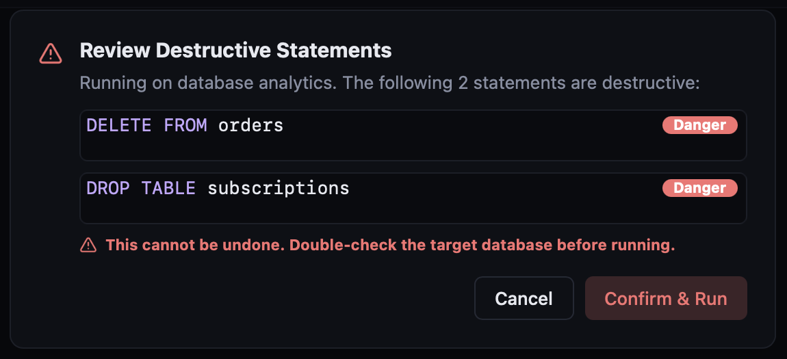

# Datum

[English](README.md) | 简体中文 | [繁體中文](README.zh-TW.md)

一款简约现代的桌面数据库管理工具,支持 **PostgreSQL**、**MySQL**、**SQLite** 与 **Redis**,可在 **macOS**、**Windows**、**Linux** 上运行。

界面用 TSX 写在 [nsh](https://nsh.dev)(Native Shell)上,由各平台自己的控件绘制——macOS 用 AppKit,Windows 用 Win32 / Direct2D,
Linux 用 GTK 4。数据层是 Rust(`crates/core`),通过原生模块提供给界面。不依赖 WebView 与 Node.js。

> Datum(/ˈdeɪtəm/,"data" 的单数)—— 专注于数据的工具。

<p align="center">
  
</p>

## 看一眼

**顺手地写 SQL。** 补全认得你的表、别名和列;⌘↵ 只跑光标所在的那一条。当然也有深色模式。



**表之间怎么关联,一眼看清。** 关系图既读取真实外键,也会按 `xxx_id` 命名推断出没建外键的关联。(当前版本暂未提供,正在移植到新界面。)



**不容易误操作。** 连接按 local / staging / prod 标色,任何破坏性语句都要你明确确认后才会执行。

<table>
  <tr>
    <td width="50%"></td>
    <td width="50%"></td>
  </tr>
</table>

<sub>截图使用一个虚构的咖啡烘焙店数据库,摄于 macOS 上的早期版本(v0.0.1)。</sub>

## 功能

- **连接管理**:新建/编辑/删除/测试连接,连接串预览;SSL 模式(关闭 / 优先 / 必须 / 校验证书,PG 与 MySQL 的「优先」在服务器不支持时退回明文);按环境(local / staging / prod)着色;凭据按环境路由——`local` 明文存本地、`staging/prod` 存系统钥匙串(macOS 钥匙串 / Windows 凭据管理器 / Linux Secret Service);侧栏切库(同实例复用或自动克隆连接)、库右键导出/删除
- **表浏览**:服务端分页与排序、列类型分级配色、结果筛选(且/或、多种操作符)、单元格全文查看(JSON 自动格式化)、暂存编辑与删除后 ⌘S 单事务提交、复制 INSERT、导出 CSV / SQL / Markdown
- **SQL 编辑器**:语法高亮、schema 感知补全(表名、`表.` / 别名列、作用域列、子句模板)、关键字自动大写、运行光标所在语句或选区、格式化、Explain、行数上限、查询历史(按库隔离)
- **破坏性语句审查**:DROP / TRUNCATE / 无 WHERE 的 DELETE、UPDATE 等执行前统一确认;Redis 的 FLUSHALL / FLUSHDB 同样拦截;只读执行由数据库强制(PG `default_transaction_read_only`、MySQL `SESSION TRANSACTION READ ONLY`、SQLite `query_only`)
- **Redis**:浏览 key、按类型展示值、执行任意命令(命令与 key 名补全)、key 详情(类型 / TTL / 大小)
- **AI 助手**:可配置多个服务商(OpenAI 兼容 / Anthropic / Gemini,内置 DeepSeek、通义、Kimi 等预设),面板内切换模型;按连接分会话;自动注入表结构与知识库文档(内置数据库开发规范,可替换);生成的 SQL 以卡片展示,确认后执行或在编辑器中运行
- **关系图**(暂未提供,打开后是占位页,正在移植):物理外键 + 按 `xxx_id` 命名推断的逻辑外键,分层布局、拖拽、缩放、搜索高亮、表结构图 / 工程 ER 图切换、导出 PNG
- **导入**:从 .sql 文件或粘贴内容单事务导入(失败整体回滚并定位到第几条)
- **界面**:简体中文 / 繁體中文 / English(默认跟随系统,AI 提示词与内置规范随语言切换)、亮色 / 暗色 / 跟随系统、字体字号设置、可拖动分栏、多标签页、应用内更新

已不再支持 MongoDB。旧版本保存的 Mongo 连接仍留在配置文件里,只是不再显示。

## 安装

从 [Releases](https://github.com/wenlingang/datum/releases) 下载:

- **macOS** 14 及以上:`Datum-<版本>-macos-aarch64.dmg`(Apple 芯片)或 `Datum-<版本>-macos-x86_64.dmg`(Intel),把 Datum 拖进「应用程序」。
- **Windows** 10 1809 及以上 / Windows 11:运行 `Datum-setup.exe`,或解压 `Datum-<版本>-windows-x86_64.zip`。
- **Linux**(x86_64,GTK 4.14 及以上):解压 `Datum-<版本>-linux-x86_64.tar.gz`,运行 `Datum/Datum`。目录里还有 `.desktop` 文件和图标,想放进启动器时可以用。

Datum 目前没有经过苹果公证,第一次打开会被系统拦截,任选一种方式放行(只需一次,之后的应用内更新不受影响):

- 打开「系统设置 → 隐私与安全性」,在页面下方找到 Datum 的提示,点「仍要打开」;
- 或在终端执行 `xattr -dr com.apple.quarantine /Applications/Datum.app`。

Windows 安装器同样没有代码签名,如果被 SmartScreen 拦下,点「更多信息」→「仍要运行」。

之后应用会自动检查更新(设置 › 关于与更新)。v0.0.1 无法自动更新到 0.1,需要手动下载一次新版。

## 结构

```text
crates/
└── core/        datum-core:连接、凭据、历史、PG/MySQL/SQLite/Redis 驱动、AI,
                 以及 SQL 切分/风险识别/生成/格式化、筛选排序导出、ER 布局、补全等纯逻辑
                 (旧的 MongoDB 驱动仍在,但应用已不再使用)
app/             nsh 应用(入口 App.tsx、nsh.json、theme.json、locales/)
├── native/      datum-native:把 datum-core 以 `datum/native` 原生模块提供给界面的 Rust crate
├── lib/         datum/native 的类型化封装,以及跨边界的数据形状
├── store/       全局状态(偏好、连接、历史、AI、更新等)
├── ui/          各页面共用的样式组件
├── workspace/   外壳:顶栏、连接竖轨、侧栏、标签条、状态栏
├── tab/         查询/表浏览标签页:编辑器、结果网格、工具条、筛选、历史、单元格编辑
├── dialogs/     连接表单、设置、导入、风险确认
├── chat/        AI 助手面板
└── testing/     run-tests.sh 及其夹具
```

## 环境要求

- **Rust** ≥ 1.97(nsh 的最低要求)
- **nsh CLI**,必须与 `app/native/Cargo.toml` 里钉住的 nsh crate 同一提交(宿主与 CLI 必须同源):用 `script/install-nsh.sh` 安装
- Linux 需要 GTK 4 开发包与 clang(Debian / Ubuntu 上是 `libgtk-4-dev clang`);Windows 需要带 C++ 工作负载的 Visual Studio Build Tools 与 Windows SDK。各平台细节见 nsh 文档
- 界面测试需要 `sqlite3`
- 跑数据层集成测试时需要本地可连的 PostgreSQL / MySQL / Redis(或 Docker)

## 开发

nsh 命令都在 `app/` 下执行:

```bash
cd app
nsh check                                  # TSX 类型检查
nsh build                                  # 构建;每条 warn 都要看
nsh test                                   # 界面测试
DATUM_CONFIG_DIR=/tmp/datum-dev nsh run    # 用独立的配置目录启动应用
```

```bash
app/testing/run-tests.sh          # 全部界面测试,每块在各自的临时配置目录里跑
app/testing/run-tests.sh tab      # 只跑一块:workspace | tab | dialogs | chat | rust
cargo test --workspace            # datum-core 单元测试(数据层集成测试默认忽略)
```

配置放在系统配置目录下的 `com.dbstudio.app` 里(macOS 是 `~/Library/Application Support`,Windows 是 `%APPDATA%`,
Linux 是 `~/.config`),与旧版共用。`DATUM_CONFIG_DIR` 可让一次运行指向别的目录,开发和测试都不会碰到你真实的连接。

nsh 重写的设计说明见 `docs/superpowers/specs/2026-11-10-nsh-rewrite-design.md`。

### 集成测试(需要数据库)

```bash
cargo test -p datum-core --lib -- --ignored --test-threads=1
```

可用环境变量覆盖测试连接:`DBSTUDIO_TEST_PG`(libpq 连接串)、`DBSTUDIO_TEST_MYSQL`(`host:port:user:password:db`)、`DBSTUDIO_TEST_REDIS`(redis URL)。

PG / MySQL 上的只读执行(SQLite 用例不需要这些变量):

```bash
DATUM_TEST_PG_DB=<库名> DATUM_TEST_MYSQL_DB=<库名> cargo test -p datum-core --test read_only -- --ignored
```

TLS 用例按端口连本机库,未设置的变量对应用例直接跳过:

```bash
DATUM_TLS_PG_PLAIN=5432 DATUM_TLS_PG_SSL=5444 DATUM_TLS_MYSQL=3306 DATUM_TLS_REDIS=6379 \
  cargo test -p datum-core --test tls -- --ignored --test-threads=1
```

`DATUM_TLS_PG_SSL` 指向开启 `ssl=on`(自签证书即可)的 PG,`DATUM_TLS_PG_PLAIN` / `DATUM_TLS_REDIS` 指向未开加密的实例。

## 打包与发布

### 发版(GitHub Actions)

1. 修改 `app/nsh.json` 的 `version`(版本号的唯一来源,`script/app-version.sh` 可打印),提交。
2. 可选试跑:Actions › Release › Run workflow。只打包不发布,可下载产物试装。
3. 推送附注标签 `v<版本>`,标签说明就是应用内显示的更新说明:

```bash
git tag -a v0.1.0 -m "本次更新内容"
git push origin v0.1.0
```

`.github/workflows/release.yml`:校验标签与版本一致 → 跑测试(`cargo test`、无 warn 的 `nsh check` / `nsh build`、
`app/testing/run-tests.sh`)→ 在 macOS(aarch64、x86_64)、Windows、Linux 的 runner 上 `nsh package` → macOS 用发版证书重签并做 dmg
(`script/sign-macos.sh`)→ `nsh update-manifest` 签名 `latest.json` → 建 Release。

Release 附件:

| 文件 | 用途 |
| --- | --- |
| `Datum-<版本>-macos-aarch64.tar.gz` / `-x86_64.tar.gz` | macOS 更新包(应用内更新下载它) |
| `Datum-<版本>-macos-aarch64.dmg` / `-x86_64.dmg` | macOS 首次安装 |
| `Datum.dmg` | Apple 芯片 dmg 的固定名副本,介绍页的下载链接不会过期 |
| `Datum-<版本>-windows-x86_64.zip`、`Datum-setup.exe` | Windows 更新包与安装器 |
| `Datum-<版本>-linux-x86_64.tar.gz` | Linux |
| `latest.json`、`latest.json.sig` | 更新清单及其签名 |
| `SHA256SUMS` | 校验和 |

版本号带 `-`(如 `v0.2.0-rc1`)时发为预发布,已安装的应用不会更新到它。

仓库 secrets(Settings → Secrets and variables → Actions):

- `RELEASE_CERT_P12` / `RELEASE_CERT_PASSWORD`:macOS 自签名发版证书 "Datum Release"
- `UPDATE_SIGNING_KEY`:更新清单签名私钥(`nsh keygen` 生成的 `update.secret` 的内容)

### 发版证书(macOS)

macOS 包用自签名证书 "Datum Release" 重签。**不要更换它**:钥匙串里对 staging / prod 密码的「始终允许」授权跟随签名,
换了证书,每位用户都得重新授权一遍。`script/release-cert.sha1` 钉住它的 SHA-1,`script/sign-macos.sh` 拒绝用其他证书签名。

一次性配置:

```bash
script/release-cert.sh        # 证书写到 ~/datum-release-cert/,指纹写到 script/release-cert.sha1
# 备份 datum-release.p12 和 password.txt,提交 script/release-cert.sha1,然后:
gh secret set RELEASE_CERT_P12 < ~/datum-release-cert/datum-release.p12.base64
gh secret set RELEASE_CERT_PASSWORD < ~/datum-release-cert/password.txt
```

### 更新签名密钥

私钥放在仓库外(`~/datum-update-key/update.secret`);公钥是 `app/nsh.json` 里的 `updater.publicKey`,
已安装的应用拒绝没有用它签名的清单。

```bash
gh secret set UPDATE_SIGNING_KEY < ~/datum-update-key/update.secret
```

### 本地打包

nsh 只为当前所在的平台打包,在 `app/` 下执行:

```bash
cd app
nsh package --target macos       # 或 windows / linux;输出在 app/.nsh/out/
../script/sign-macos.sh .nsh/out aarch64   # 可选,macOS:用 "Datum Release" 重签并做 dmg
```

`nsh package` 给 macOS 应用做的是 ad hoc 签名,本机试用没问题。

### 应用内更新

更新走 `nsh/updater`(见 `app/store/update.ts`):`nsh.json` 的 `updater` 指向本 GitHub 仓库并带公钥。打包后的应用启动 10 秒后
首次检查,之后每 4 小时检查一次最新 Release 里的 `latest.json`,校验签名后下载本平台的更新包,核对大小与 SHA-256,替换自身并重启。
开发运行(`nsh run`)不会更新。它与 v0.0.1 的旧更新器不兼容,旧版用户需要手动下载一次新版。

## 快捷键

Windows 与 Linux 上用 Ctrl 代替 ⌘。

| 快捷键 | 作用 |
| --- | --- |
| ⌘↵ | 运行光标所在语句 / 选区 |
| ⌘⇧F | 格式化 SQL |
| ⌘E | Explain |
| ⌘Y | 查询历史 |
| ⌘⇧A | 把选中 SQL 发给 AI 助手 |
| ⌘F | 结果筛选(编辑器内为查找) |
| ⌘S | 提交暂存的编辑与删除 |
| ⌘R | 刷新当前标签页与表列表 |
| ⌘T / ⌘W | 新建查询 / 关闭标签页 |
| ⌘B | 显示 / 隐藏侧栏 |
| ⌘, | 设置 |
