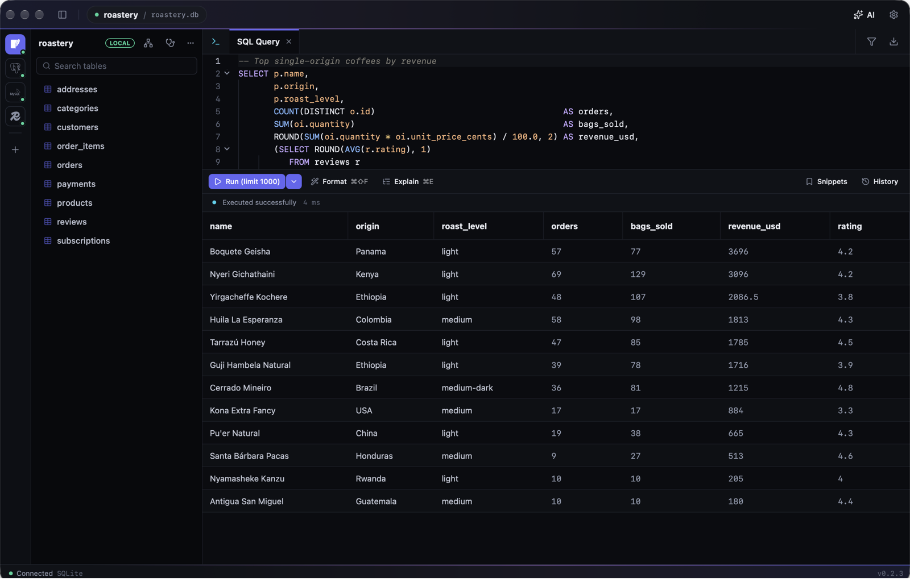
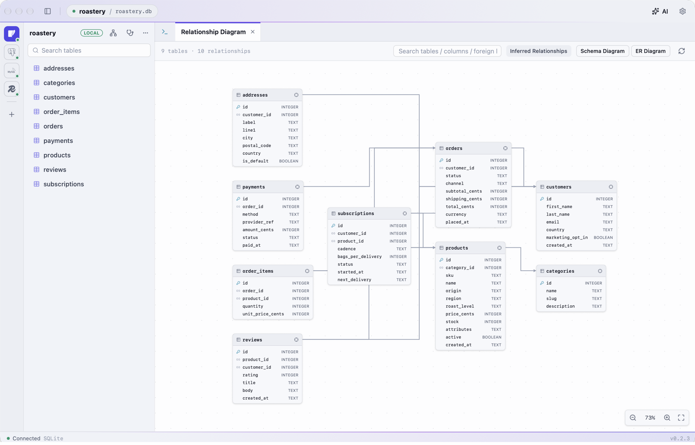
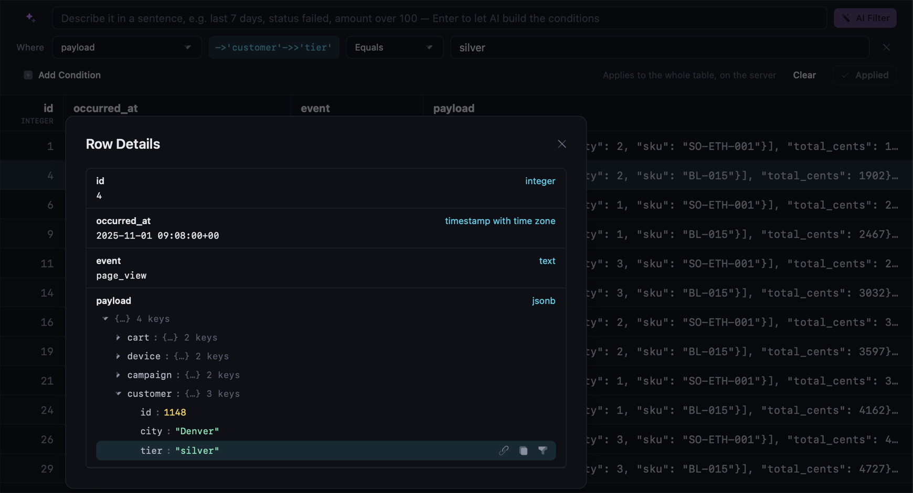
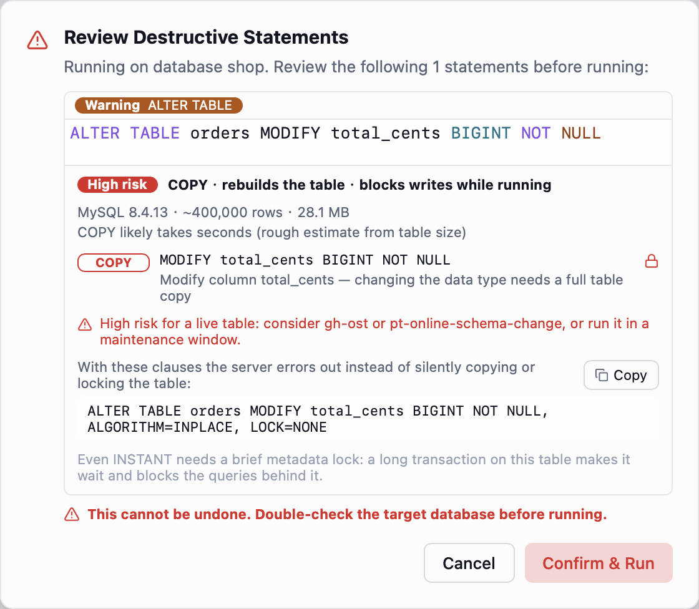
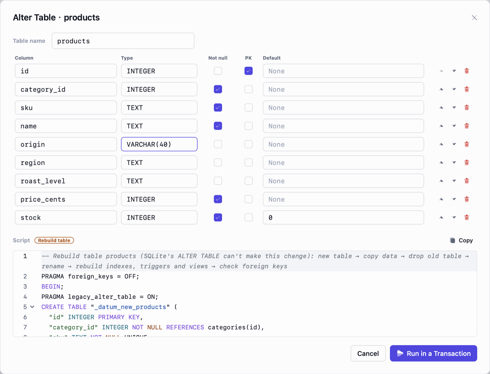
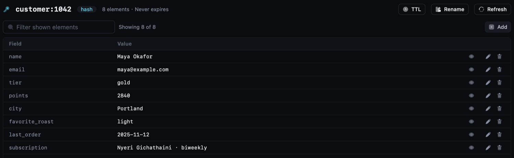
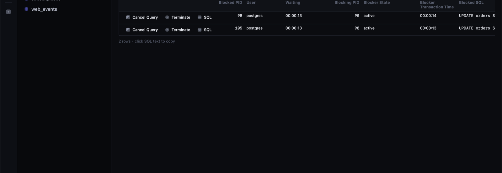

# Datum

[English](README.md) | 简体中文 | [繁體中文](README.zh-TW.md)

一款轻量、启动快的桌面数据库管理工具,支持 **PostgreSQL**、**MySQL**、**SQLite** 与 **Redis**,可在 **macOS**、**Windows**、**Linux** 上运行。

**👉 介绍、截图、功能与下载:[wenlingang.github.io/datum](https://wenlingang.github.io/datum/)**

<p align="center">
  <a href="https://wenlingang.github.io/datum/"></a>
</p>

## 截图

<table>
  <tr>
    <td width="50%" valign="top"><br><sub>关系图:所有表与外键,包括按列名推断出的关联</sub></td>
    <td width="50%" valign="top"><br><sub>PostgreSQL JSONB:在树上点字段,就按它筛选整张表</sub></td>
  </tr>
  <tr>
    <td width="50%" valign="top"><br><sub>MySQL:执行 ALTER TABLE 前先知道会不会整表复制、会不会挡住写入</sub></td>
    <td width="50%" valign="top"><br><sub>SQLite:在表单里改列,Datum 写好重建表脚本</sub></td>
  </tr>
  <tr>
    <td width="50%" valign="top"><br><sub>Redis:Hash、List、Set、ZSet、Stream 都能像表格一样编辑</sub></td>
    <td width="50%" valign="top"><br><sub>诊断:会话、锁等待、慢 SQL、未使用的索引</sub></td>
  </tr>
</table>

## 下载

从 [Releases](https://github.com/wenlingang/datum/releases/latest) 下载对应平台的安装包,安装说明见[介绍页](https://wenlingang.github.io/datum/#install)。

## 开发

界面用 TSX 写在 [nsh](https://nsh.dev) 上,由各平台原生控件绘制;数据层是 Rust(`crates/core`),经原生模块 `app/native` 提供给界面。

```text
crates/core/   数据层:连接、凭据、历史、PG/MySQL/SQLite/Redis 驱动、AI、SQL 风险识别与格式化等
app/           nsh 应用:App.tsx、nsh.json、theme.json、locales/
  native/      原生模块 datum/native(Rust)
  workspace/   外壳   tab/ 查询与表浏览   dialogs/ 对话框   chat/ AI 面板   ui/ store/ lib/
site/          介绍页(GitHub Pages)
```

需要 Rust ≥ 1.97 与 nsh CLI(必须与 `app/native/Cargo.toml` 钉住的 nsh 同一提交,用 `script/install-nsh.sh` 安装)。

```bash
cd app
nsh check && nsh build                     # 类型检查与构建
DATUM_CONFIG_DIR=/tmp/datum-dev nsh run    # 用独立的配置目录启动,不碰真实连接
cd .. && app/testing/run-tests.sh core     # 核心测试
```

测试、打包、发版与证书 / 密钥等维护细节见 [docs/release.md](docs/release.md)。
