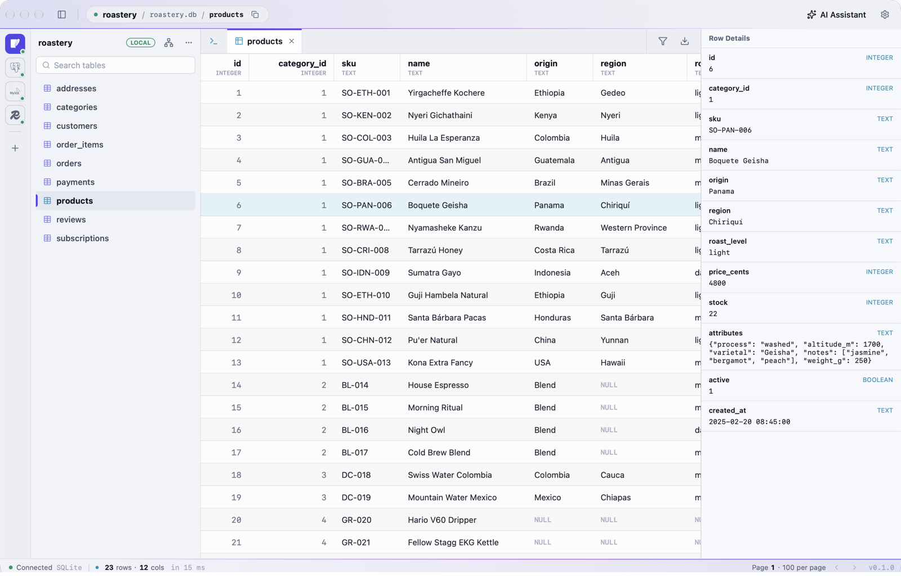
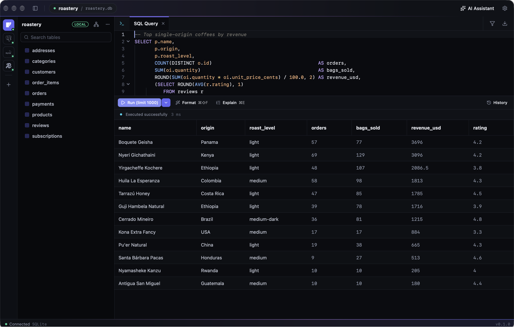
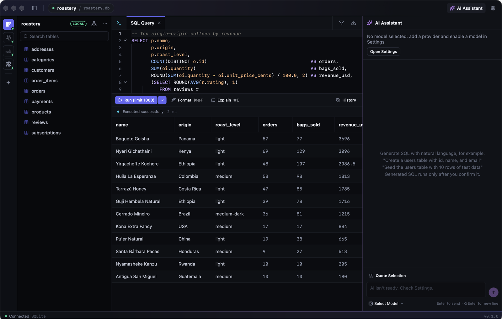
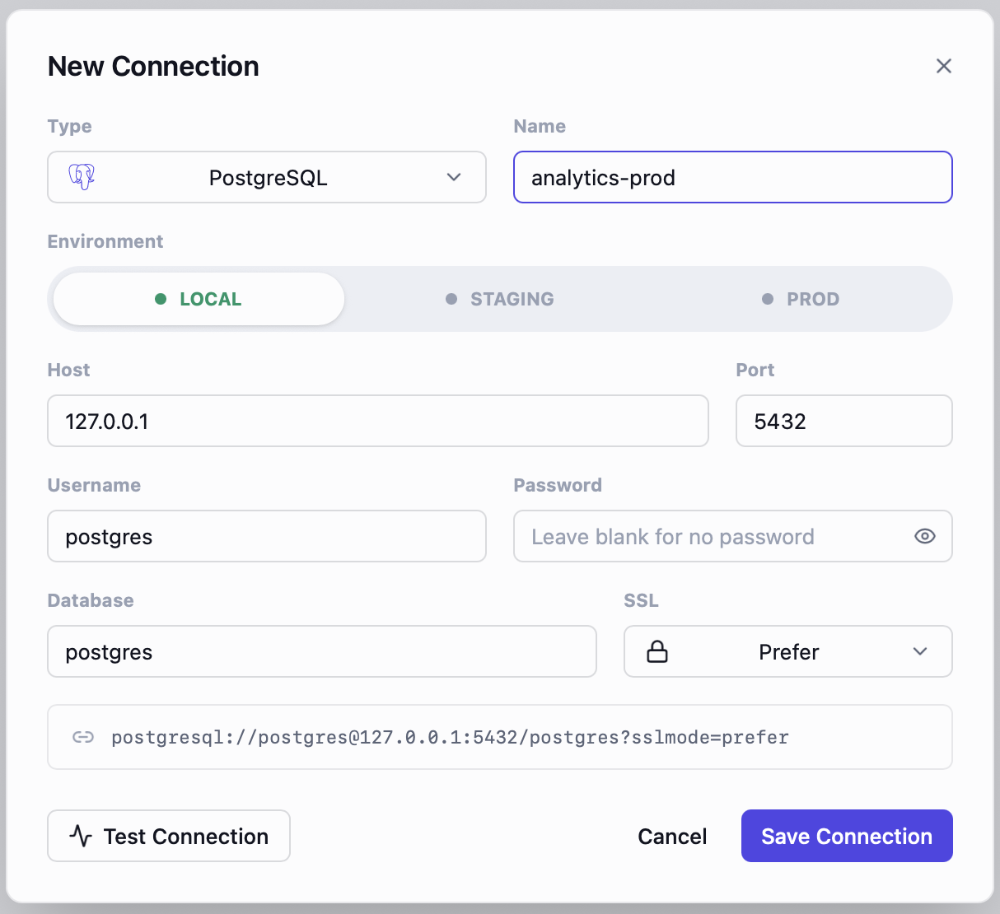
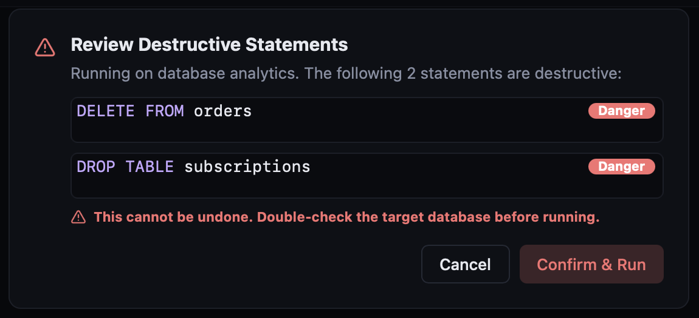

# Datum

[English](README.md) | [简体中文](README.zh-CN.md) | 繁體中文

一款輕量、啟動快、簡約現代的桌面資料庫管理工具,支援 **PostgreSQL**、**MySQL**、**SQLite** 與 **Redis**,可在 **macOS**、**Windows**、**Linux** 上執行。

介面以 TSX 寫在 [nsh](https://nsh.dev)(Native Shell)上,由各平台自己的元件繪製——macOS 用 AppKit,Windows 用 Win32 / Direct2D,
Linux 用 GTK 4。資料層是 Rust(`crates/core`),透過原生模組提供給介面。不依賴 WebView 與 Node.js。

> Datum(/ˈdeɪtəm/,"data" 的單數)—— 專注於資料的工具。

<p align="center">
  
</p>

## 看一眼

**順手地寫 SQL。** 補全認得你的資料表、別名與欄位;⌘↵ 只執行游標所在的那一句。當然也有深色模式。



**用一句話描述你要的資料。** AI 助理就在分頁旁邊,認得目前連線的資料表。服務供應商自己設定(OpenAI 相容 / Anthropic / Gemini),它寫的 SQL 要你確認後才會執行。



**不容易誤操作。** 連線依 local / staging / prod 標色,任何破壞性語句都要你明確確認後才會執行。

<table>
  <tr>
    <td width="50%"></td>
    <td width="50%"></td>
  </tr>
</table>

## 功能

- **連線管理**:新增/編輯/刪除/測試連線,連線字串預覽;SSL 模式(關閉 / 優先 / 必須 / 驗證憑證,PG 與 MySQL 的「優先」在伺服器不支援時退回明文);依環境(local / staging / prod)著色;憑證依環境存放——`local` 明文存於本機、`staging/prod` 存於系統鑰匙圈(macOS 鑰匙圈 / Windows 認證管理員 / Linux Secret Service);側欄切換資料庫(同一執行個體共用或自動複製連線)、資料庫右鍵匯出/刪除
- **資料表瀏覽**:伺服器端分頁與排序、欄位型別分級配色、結果篩選(且/或、多種運算子)、儲存格全文檢視(JSON 自動格式化)、暫存編輯與刪除後 ⌘S 單一交易提交、複製 INSERT、匯出 CSV / SQL / Markdown
- **SQL 編輯器**:語法醒目提示、schema 感知自動完成(資料表名稱、`表.` / 別名欄位、作用域欄位、子句範本)、關鍵字自動大寫、執行游標所在陳述式或選取範圍、格式化、Explain、列數上限、查詢紀錄(依資料庫隔離)
- **破壞性陳述式審查**:DROP / TRUNCATE / 無 WHERE 的 DELETE、UPDATE 等執行前統一確認;Redis 的 FLUSHALL / FLUSHDB 同樣攔截;唯讀執行由資料庫強制(PG `default_transaction_read_only`、MySQL `SESSION TRANSACTION READ ONLY`、SQLite `query_only`)
- **Redis**:瀏覽 key、依型別顯示值、執行任意命令(命令與 key 名稱自動完成)、key 詳細資訊(型別 / TTL / 大小)
- **AI 助理**:可設定多個服務供應商(OpenAI 相容 / Anthropic / Gemini,內建 DeepSeek、通義、Kimi 等預設),在面板內切換模型;依連線分開對話;自動帶入資料表結構與知識庫文件(內建資料庫開發規範,可替換);產生的 SQL 以卡片呈現,確認後執行或在編輯器中執行
- **關聯圖(ER 圖)**:尚未提供,開啟後是預留頁面,正在移植到新介面
- **匯入**:從 .sql 檔案或貼上的內容以單一交易匯入(失敗整體復原並定位到第幾條)
- **介面**:English / 简体中文 / 繁體中文(預設跟隨系統,AI 提示詞與內建規範隨語言切換)、淺色 / 深色 / 跟隨系統、字型與字級設定、可拖曳分欄、多分頁、App 內更新

已不再支援 MongoDB。舊版本儲存的 Mongo 連線仍保留在設定檔中,只是不再顯示。

## 效能

Datum 不內嵌瀏覽器:介面由各平台原生視圖繪製,元件只在依賴的資料變化時更新對應部分,不整頁重繪。所以安裝包小、佔用少,大表也能很快顯示出來。

| 項目 | 實測 |
| --- | --- |
| 安裝包 | macOS dmg 約 33 MB(Apple 晶片;Intel 約 36 MB),應用程式內更新包約 29 MB;Windows 安裝程式約 22 MB;Linux tar.gz 約 33 MB |
| 啟動 | 從啟動到視窗出現約 0.2 秒 |
| 閒置記憶體 | 約 31 MB |
| 開啟 100 萬列的表 | 首頁約 0.1 秒(伺服器端分頁,每頁 100 列) |
| 查詢傳回 10 萬列 × 10 欄 | 從執行到顯示在表格裡約 0.3 秒,其中取得資料後上屏約 40 ms |

- 結果表是虛擬化的(nsh 的 DataTable):只為可見區域的儲存格建立視圖,捲動時重複使用。
- 表瀏覽走伺服器端分頁,再大的表開啟也只取一頁;查詢結果預設最多 1000 列(可在設定裡調整)。

<sub>測試環境:Apple M4、24 GB 記憶體、macOS 27.2,正式發布的 release 建置,本機 SQLite 資料庫。啟動時間為 5 次量測(0.17–0.20 s);記憶體為 macOS 的記憶體用量(footprint),即「活動監視器」顯示的數字。100 萬列表首頁 81–93 ms;10 萬列上屏 26–40 ms,載入後記憶體約 255 MB。另見 nsh 的[效能報告](https://nsh.dev/docs/performance-report)。</sub>

## 安裝

從 [Releases](https://github.com/wenlingang/datum/releases) 下載:

- **macOS** 14 以上:`Datum-<版本>-macos-aarch64.dmg`(Apple 晶片)或 `Datum-<版本>-macos-x86_64.dmg`(Intel),將 Datum 拖進「應用程式」。
- **Windows** 10 1809 以上 / Windows 11:執行 `Datum-setup.exe`,或解壓縮 `Datum-<版本>-windows-x86_64.zip`。
- **Linux**(x86_64,GTK 4.14 以上與 WebKitGTK 6.0):解壓縮 `Datum-<版本>-linux-x86_64.tar.gz`,執行 `Datum/Datum`。目錄中還有 `.desktop` 檔案與圖示,想放進啟動器時可以使用。

Datum 目前尚未經過 Apple 公證,第一次開啟會被系統阻擋,任選一種方式放行(只需一次,之後的 App 內更新不受影響):

- 開啟「系統設定 → 隱私權與安全性」,在頁面下方找到 Datum 的提示,點選「強制打開」;
- 或在終端機執行 `xattr -dr com.apple.quarantine /Applications/Datum.app`。

Windows 安裝程式同樣沒有程式碼簽章,若被 SmartScreen 擋下,點選「其他資訊」→「仍要執行」。

之後 App 會自動檢查更新(設定 › 關於與更新)。v0.0.1 無法自動更新到 0.1,需要手動下載一次新版。

## 結構

```text
crates/
└── core/        datum-core:連線、憑證、紀錄、PG/MySQL/SQLite/Redis 驅動程式、AI,
                 以及 SQL 切分/風險辨識/產生/格式化、篩選排序匯出、ER 配置、自動完成等純邏輯
                 (舊的 MongoDB 驅動程式仍在,但 App 已不再使用)
app/             nsh App(進入點 App.tsx、nsh.json、theme.json、locales/)
├── native/      datum-native:把 datum-core 以 `datum/native` 原生模組提供給介面的 Rust crate
├── lib/         datum/native 的型別化封裝,以及跨邊界的資料形狀
├── store/       全域狀態(偏好、連線、紀錄、AI、更新等)
├── ui/          各頁面共用的樣式元件
├── workspace/   外殼:頂欄、連線直欄、側欄、分頁列、狀態列
├── tab/         查詢/資料表瀏覽分頁:編輯器、結果表格、工具列、篩選、紀錄、儲存格編輯
├── dialogs/     連線表單、設定、匯入、風險確認
├── chat/        AI 助理面板
└── testing/     run-tests.sh 及其測試資料
```

## 環境需求

- **Rust** ≥ 1.97(nsh 的最低需求)
- **nsh CLI**,必須與 `app/native/Cargo.toml` 中釘住的 nsh crate 為同一提交(宿主與 CLI 必須同源):以 `script/install-nsh.sh` 安裝
- Linux 需要 GTK 4 開發套件與 clang(Debian / Ubuntu 上是 `libgtk-4-dev clang`);Windows 需要含 C++ 工作負載的 Visual Studio Build Tools 與 Windows SDK。各平台細節見 nsh 文件
- 介面測試需要 `sqlite3`
- 執行資料層整合測試時需要本機可連線的 PostgreSQL / MySQL / Redis(或 Docker)

## 開發

nsh 命令都在 `app/` 下執行:

```bash
cd app
nsh check                                  # TSX 型別檢查
nsh build                                  # 建置;每一條 warn 都要看
nsh test                                   # 介面測試
DATUM_CONFIG_DIR=/tmp/datum-dev nsh run    # 以獨立的設定目錄啟動 App
```

```bash
app/testing/run-tests.sh          # 全部介面測試,每一塊在各自的暫存設定目錄中執行
app/testing/run-tests.sh tab      # 只跑一塊:workspace | tab | dialogs | chat | rust
cargo test --workspace            # datum-core 單元測試(資料層整合測試預設略過)
```

設定放在系統設定目錄下的 `com.dbstudio.app` 中(macOS 是 `~/Library/Application Support`,Windows 是 `%APPDATA%`,
Linux 是 `~/.config`),與舊版共用。`DATUM_CONFIG_DIR` 可讓一次執行指向別的目錄,開發與測試都不會碰到你真實的連線。

nsh 重寫的設計說明見 `docs/superpowers/specs/2026-11-10-nsh-rewrite-design.md`。

### 整合測試(需要資料庫)

```bash
cargo test -p datum-core --lib -- --ignored --test-threads=1
```

可用環境變數覆寫測試連線:`DBSTUDIO_TEST_PG`(libpq 連線字串)、`DBSTUDIO_TEST_MYSQL`(`host:port:user:password:db`)、`DBSTUDIO_TEST_REDIS`(redis URL)。

PG / MySQL 上的唯讀執行(SQLite 測試不需要這些變數):

```bash
DATUM_TEST_PG_DB=<資料庫名稱> DATUM_TEST_MYSQL_DB=<資料庫名稱> cargo test -p datum-core --test read_only -- --ignored
```

TLS 測試依連接埠連線本機資料庫,未設定的變數對應的測試直接略過:

```bash
DATUM_TLS_PG_PLAIN=5432 DATUM_TLS_PG_SSL=5444 DATUM_TLS_MYSQL=3306 DATUM_TLS_REDIS=6379 \
  cargo test -p datum-core --test tls -- --ignored --test-threads=1
```

`DATUM_TLS_PG_SSL` 指向開啟 `ssl=on`(自簽憑證即可)的 PG,`DATUM_TLS_PG_PLAIN` / `DATUM_TLS_REDIS` 指向未開啟加密的執行個體。

## 封裝與發布

### 發版(GitHub Actions)

1. 修改 `app/nsh.json` 的 `version`(版本號的唯一來源,`script/app-version.sh` 可印出),提交。
2. 可選試跑:Actions › Release › Run workflow。只封裝不發布,可下載產物試裝。
3. 推送附註標籤 `v<版本>`,標籤說明就是 App 內顯示的更新說明:

```bash
git tag -a v0.1.0 -m "本次更新內容"
git push origin v0.1.0
```

`.github/workflows/release.yml`:檢查標籤與版本一致 → 跑測試(`cargo test`、無 warn 的 `nsh check` / `nsh build`、
`app/testing/run-tests.sh`)→ 在 macOS(aarch64、x86_64)、Windows、Linux 的 runner 上 `nsh package` → macOS 以發行憑證重新簽署並製作 dmg
(`script/sign-macos.sh`)→ `nsh update-manifest` 簽署 `latest.json` → 建立 Release。

Release 附件:

| 檔案 | 用途 |
| --- | --- |
| `Datum-<版本>-macos-aarch64.tar.gz` / `-x86_64.tar.gz` | macOS 更新套件(App 內更新下載它) |
| `Datum-<版本>-macos-aarch64.dmg` / `-x86_64.dmg` | macOS 首次安裝 |
| `Datum.dmg` | Apple 晶片 dmg 的固定名稱副本,介紹頁的下載連結不會過期 |
| `Datum-<版本>-windows-x86_64.zip`、`Datum-setup.exe` | Windows 更新套件與安裝程式 |
| `Datum-<版本>-linux-x86_64.tar.gz` | Linux |
| `latest.json`、`latest.json.sig` | 更新清單及其簽章 |
| `SHA256SUMS` | 校驗和 |

版本號帶 `-`(如 `v0.2.0-rc1`)時發為預發布,已安裝的 App 不會更新到它。

儲存庫 secrets(Settings → Secrets and variables → Actions):

- `RELEASE_CERT_P12` / `RELEASE_CERT_PASSWORD`:macOS 自簽發行憑證 "Datum Release"
- `UPDATE_SIGNING_KEY`:更新清單簽署私鑰(`nsh keygen` 產生的 `update.secret` 的內容)

### 發行憑證(macOS)

macOS 套件以自簽憑證 "Datum Release" 重新簽署。**不要更換它**:鑰匙圈中對 staging / prod 密碼的「永遠允許」授權跟隨簽章,
換了憑證,每位使用者都得重新授權一次。`script/release-cert.sha1` 釘住它的 SHA-1,`script/sign-macos.sh` 拒絕以其他憑證簽署。

一次性設定:

```bash
script/release-cert.sh        # 憑證寫到 ~/datum-release-cert/,指紋寫到 script/release-cert.sha1
# 備份 datum-release.p12 與 password.txt,提交 script/release-cert.sha1,然後:
gh secret set RELEASE_CERT_P12 < ~/datum-release-cert/datum-release.p12.base64
gh secret set RELEASE_CERT_PASSWORD < ~/datum-release-cert/password.txt
```

### 更新簽署金鑰

私鑰放在儲存庫外(`~/datum-update-key/update.secret`);公鑰是 `app/nsh.json` 中的 `updater.publicKey`,
已安裝的 App 會拒絕沒有以它簽署的清單。

```bash
gh secret set UPDATE_SIGNING_KEY < ~/datum-update-key/update.secret
```

### 本機封裝

nsh 只為目前所在的平台封裝,在 `app/` 下執行:

```bash
cd app
nsh package --target macos       # 或 windows / linux;輸出在 app/.nsh/out/
../script/sign-macos.sh .nsh/out aarch64   # 可選,macOS:以 "Datum Release" 重新簽署並製作 dmg
```

`nsh package` 為 macOS App 做的是 ad hoc 簽署,本機試用沒問題。

### App 內更新

更新走 `nsh/updater`(見 `app/store/update.ts`):`nsh.json` 的 `updater` 指向本 GitHub 儲存庫並帶公鑰。封裝後的 App 啟動 10 秒後
首次檢查,之後每 4 小時檢查一次最新 Release 中的 `latest.json`,驗證簽章後下載本平台的更新套件,核對大小與 SHA-256,替換自身並重新啟動。
開發執行(`nsh run`)不會更新。它與 v0.0.1 的舊更新器不相容,舊版使用者需要手動下載一次新版。

## 快速鍵

Windows 與 Linux 上以 Ctrl 取代 ⌘。

| 快速鍵 | 作用 |
| --- | --- |
| ⌘↵ | 執行游標所在陳述式 / 選取範圍 |
| ⌘⇧F | 格式化 SQL |
| ⌘E | Explain |
| ⌘Y | 查詢紀錄 |
| ⌘⇧A | 將選取的 SQL 傳給 AI 助理 |
| ⌘F | 結果篩選(編輯器內為尋找) |
| ⌘S | 提交暫存的編輯與刪除 |
| ⌘R | 重新整理目前分頁與資料表清單 |
| ⌘T / ⌘W | 新增查詢 / 關閉分頁 |
| ⌘B | 顯示 / 隱藏側欄 |
| ⌘, | 設定 |
