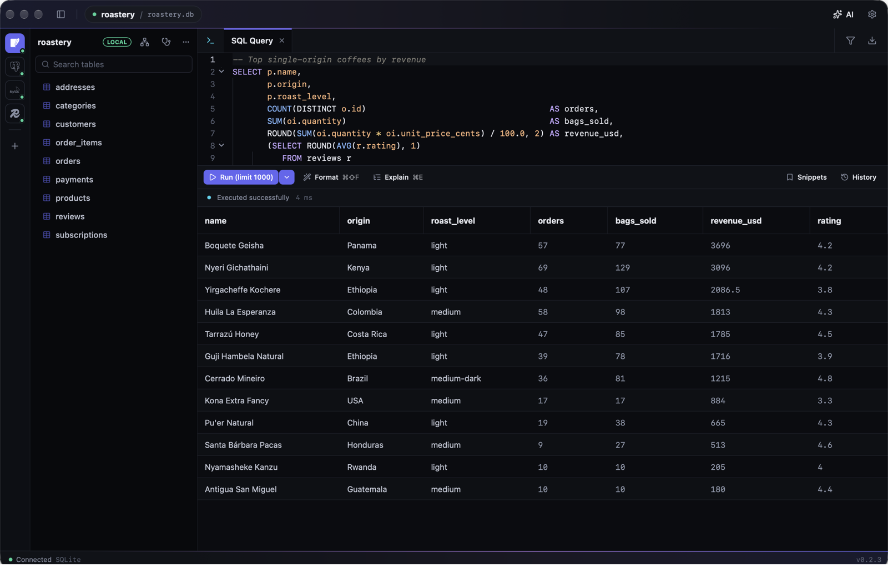
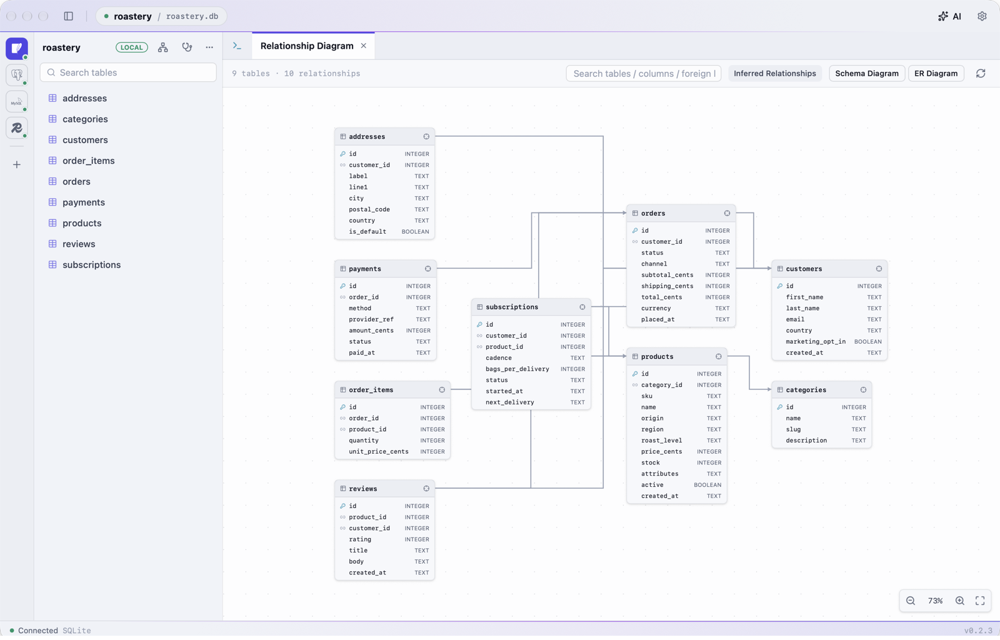
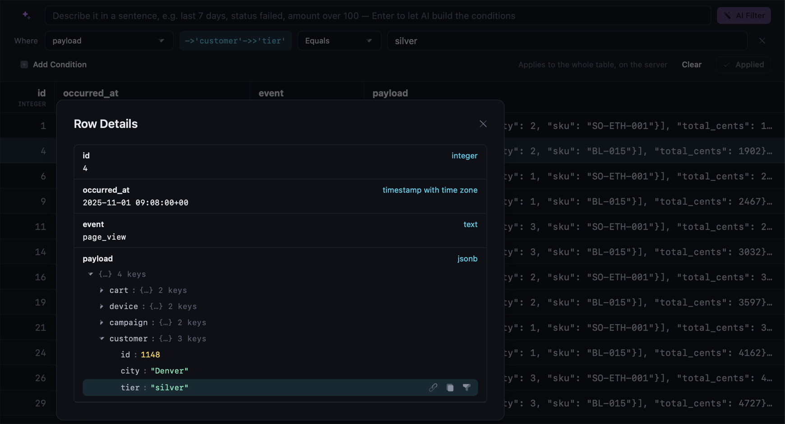
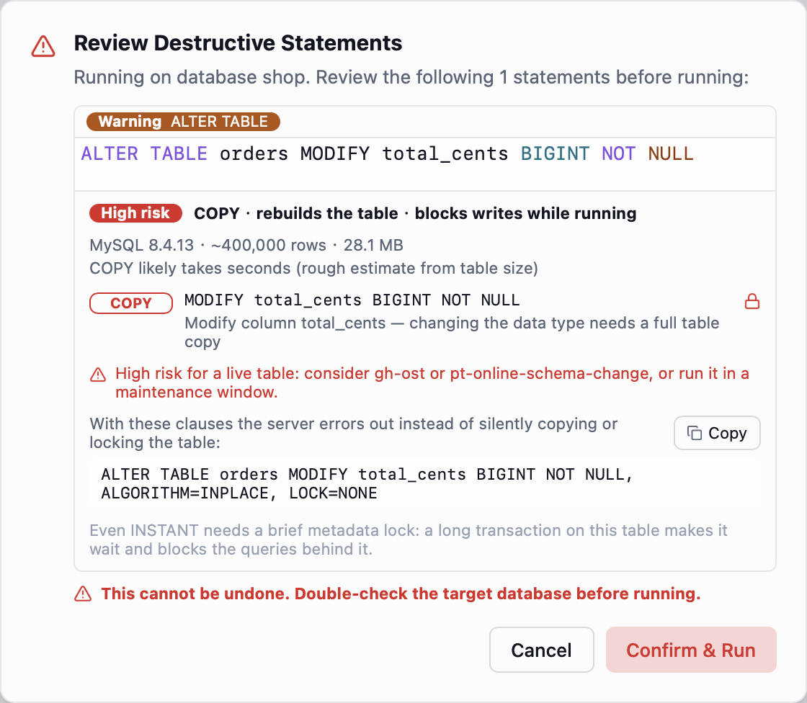
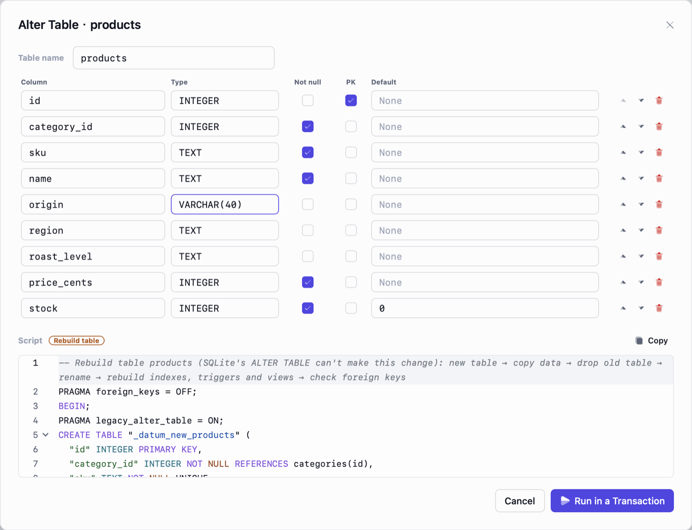
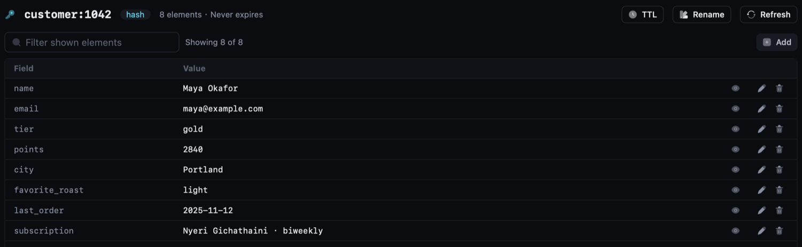
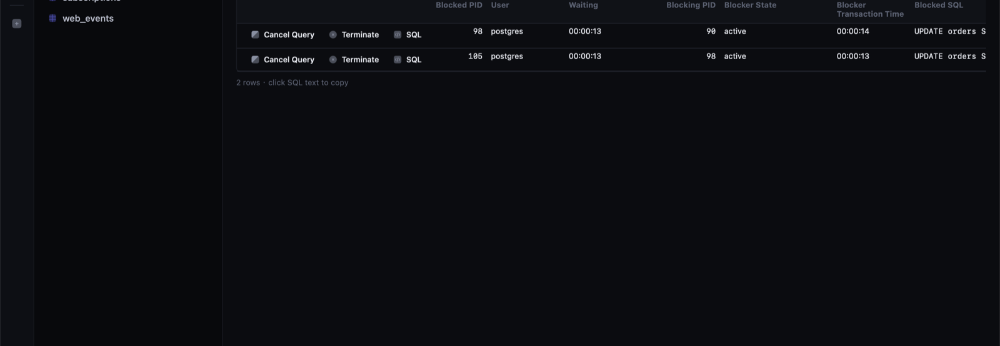

# Datum

[English](README.md) | [简体中文](README.zh-CN.md) | 繁體中文

一款輕量、啟動快的桌面資料庫管理工具,支援 **PostgreSQL**、**MySQL**、**SQLite** 與 **Redis**,可在 **macOS**、**Windows**、**Linux** 上執行。

**👉 介紹、截圖、功能與下載:[wenlingang.github.io/datum](https://wenlingang.github.io/datum/)**

<p align="center">
  <a href="https://wenlingang.github.io/datum/"></a>
</p>

## 截圖

<table>
  <tr>
    <td width="50%" valign="top"><br><sub>關聯圖:所有資料表與外鍵,包括依欄位名稱推斷出的關聯</sub></td>
    <td width="50%" valign="top"><br><sub>PostgreSQL JSONB:在樹上點欄位,就依它篩選整張資料表</sub></td>
  </tr>
  <tr>
    <td width="50%" valign="top"><br><sub>MySQL:執行 ALTER TABLE 前先知道會不會整表複製、會不會擋住寫入</sub></td>
    <td width="50%" valign="top"><br><sub>SQLite:在表單裡修改欄位,Datum 寫好重建資料表的腳本</sub></td>
  </tr>
  <tr>
    <td width="50%" valign="top"><br><sub>Redis:Hash、List、Set、ZSet、Stream 都能像表格一樣編輯</sub></td>
    <td width="50%" valign="top"><br><sub>診斷:工作階段、鎖定等待、慢 SQL、未使用的索引</sub></td>
  </tr>
</table>

## 下載

從 [Releases](https://github.com/wenlingang/datum/releases/latest) 下載對應平台的安裝檔,安裝說明見[介紹頁](https://wenlingang.github.io/datum/#install)。

## 開發

介面以 TSX 寫在 [nsh](https://nsh.dev) 上,由各平台原生控制項繪製;資料層是 Rust(`crates/core`),經原生模組 `app/native` 提供給介面。

```text
crates/core/   資料層:連線、憑證、歷史、PG/MySQL/SQLite/Redis 驅動、AI、SQL 風險辨識與格式化等
app/           nsh 應用程式:App.tsx、nsh.json、theme.json、locales/
  native/      原生模組 datum/native(Rust)
  workspace/   外殼   tab/ 查詢與資料表瀏覽   dialogs/ 對話框   chat/ AI 面板   ui/ store/ lib/
site/          介紹頁(GitHub Pages)
```

需要 Rust ≥ 1.97 與 nsh CLI(必須與 `app/native/Cargo.toml` 釘住的 nsh 同一提交,以 `script/install-nsh.sh` 安裝)。

```bash
cd app
nsh check && nsh build                     # 型別檢查與建置
DATUM_CONFIG_DIR=/tmp/datum-dev nsh run    # 以獨立的設定目錄啟動,不動到真實連線
cd .. && app/testing/run-tests.sh core     # 核心測試
```

測試、打包、發版與憑證 / 金鑰等維護細節見 [docs/release.md](docs/release.md)(簡體中文)。
